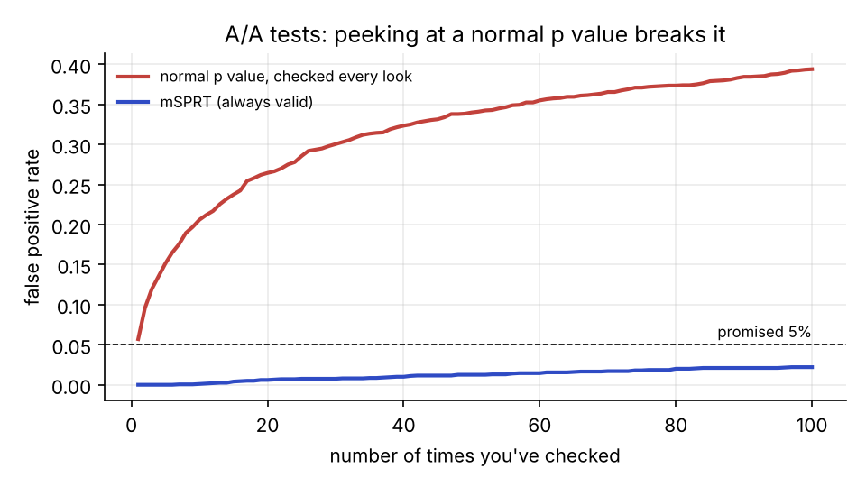
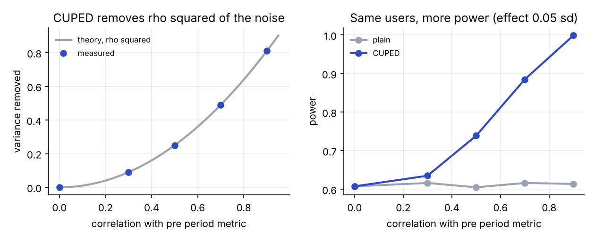
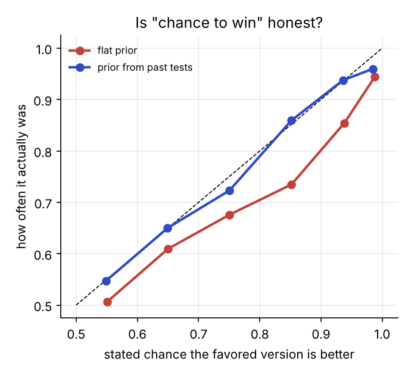
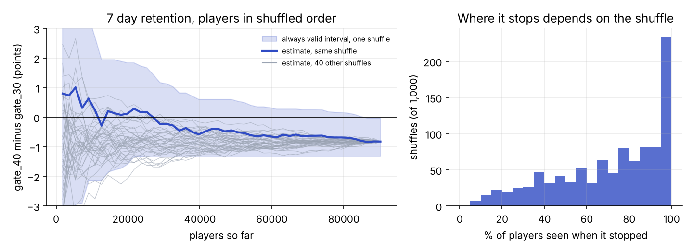

# abkit

A small Python library for analyzing online A/B tests the way big product teams do it, plus the simulations that prove each method works and an analysis of a real experiment.

**Try it in your browser:** the [Experiment Lab](https://matinnikoo.github.io/lab.html) runs the same math on a real 90,000 player test or on your own CSV, step by step. Its numbers match this library's.

Most A/B test tutorials stop at a t test. Real experiments run into a few problems that a t test doesn't handle:

* **People check results every day.** If you peek at a normal p value and stop the first time it dips under 0.05, your false positive rate isn't 5%. In my simulations it was 21% after 10 looks and 39% after 100.
* **Experiments are noisy and users are expensive.** You can cut the noise a lot by using what you already knew about each user before the test started (CUPED).
* **Some metrics are ratios**, like clicks per session. Treating every session as independent makes the intervals too narrow.
* **Assignment breaks.** If you meant to split users 50/50 and got 49.6/50.4 on 90,000 players, something is wrong and nothing downstream can be trusted.
* **People want "what's the chance B is better?"**, not a p value. That's a fair question, but the usual flat prior answer is overconfident when real effects are small, which they usually are.
* **Teams track lots of metrics and slice by segment.** Test 20 metrics, or split results by 10 countries, and you'll usually find a fake win somewhere.

abkit handles all of these.

```python
import abkit as ab

exp = ab.Experiment(df, variant="group", control="A", treatment="B")
exp.check(pre_period=["visits_last_month"])        # sample ratio and balance checks
print(exp.analyze("revenue", covariate="revenue_last_month"))   # CUPED
print(exp.analyze_ratio("clicks", "sessions"))     # delta method
exp.analyze_many(["clicks", "orders", "revenue"])  # with false discovery rate control
print(exp.sequential("orders", mde=0.01))          # safe to check every day
table, p_differ = exp.segments("orders", by="country")   # per segment, plus "do they really differ?"
print(exp.bayes("orders", prior_sd=0.004))         # chance B is better, with a prior from past tests
```

Or from the command line, with a CSV that has one row per user:

```bash
abkit report results.csv --variant group --control A --treatment B --metrics orders revenue --covariate revenue_last_month --segment country
abkit size --baseline 0.19 --mde 0.01      # how many users do I need?
```

## Does it actually work?

I can't prove a method works on real data, because I never know the true answer there. So every method gets tested on thousands of made up experiments where I do know it. Everything below comes from `simulations/run_simulations.py`.



| Claim | What I measured |
|---|---|
| Peeking at a normal p value breaks it | 2,000 A/A tests (no real difference), checked 100 times each: 39% falsely "won". The always valid test: 2.2%. |
| Always valid testing costs a little power but often stops early | For an effect of 0.06 sd: 92% power vs 99% for a single look at the end, but it stopped after 45% of the users on average. |
| CUPED removes about rho squared of the variance | Measured 9%, 25%, 49%, 81% at correlations 0.3, 0.5, 0.7, 0.9. Theory says 9%, 25%, 49%, 81%. |
| CUPED doesn't break the confidence intervals | 95% intervals covered the true effect 94% to 96% of the time at every correlation. |
| More pre period metrics remove more noise | One covariate removed 25% of the variance, two removed 50%, matching theory exactly. |
| Ratio metrics need the delta method | 95% intervals covered 96% of the time with the delta method, only 88% treating sessions as independent. |
| The sample size formula gives the power it promises | Promised 80%, got 82%, 80% and 79%. |
| Multiple testing corrections work | 20 metrics, 15 with no effect: some false win 53% of the time uncorrected, 4.4% with Holm. Benjamini Hochberg kept false discoveries at 3.8%. |
| A flat prior's "chance to win" is overconfident on small effects | When it said 85%, the better version won only 73% of the time. With a prior matching past tests, 86%. |
| Slicing by segment finds fake wins | A treatment that did nothing in any of 10 segments still looked significant in at least one segment 41% of the time. With the correction, 5.8%. The test for "do segments really differ" fired 6.1% of the time. |





## A real experiment: Cookie Cats

[Cookie Cats](analysis/cookie_cats.py) is a mobile puzzle game. 90,189 new players were randomly split between two versions. One put the first gate (where you wait or pay to keep playing) at level 30, the other at level 40.

* **The split check failed.** 44,700 vs 45,489 players, a sample ratio mismatch with p = 0.009. In a real company this would mean stopping to find out why before trusting anything. It's an easy check to skip.
* **Moving the gate later hurt 7 day retention.** 19.0% vs 18.2%, a 4.3% relative drop (95% CI 1.7% to 6.9%), and it holds after correcting for testing three metrics (adjusted p = 0.005).
* **1 day retention and rounds played didn't clearly change.**
* **Replayed as if someone checked it 50 times**, the always valid test still reaches the same call, on average after about 74% of the players.



The data has no timestamps, so the replay uses random arrival orders, and the mismatch means the retention result should be taken with some caution.

## What's in here

| Path | What it is |
|---|---|
| `abkit/core.py` | Welch t test, delta method for ratio metrics and relative lift, CUPED with one or more covariates, sample ratio check, segment heterogeneity test, sample size |
| `abkit/sequential.py` | mSPRT always valid p values and confidence sequences |
| `abkit/multiple.py` | Holm and Benjamini Hochberg |
| `abkit/bayes.py` | Chance to win, expected loss, and an optional prior from past experiments |
| `abkit/experiment.py` | The `Experiment` class that ties it together |
| `abkit/cli.py` | The `abkit` command |
| `tests/` | 23 tests, run with `pytest -q` |
| `simulations/` | The simulations behind every claim above |
| `analysis/` | The Cookie Cats analysis |
| `docs/design.md` | Why the library is built the way it is |
| `paper/abkit.pdf` | A short write up of the methods and results |

## Run it

```bash
pip install -e ".[dev]"
pytest -q
python simulations/run_simulations.py
python analysis/get_data.py && python analysis/cookie_cats.py
```

## References

* Deng, Xu, Kohavi and Walker (2013). Improving the sensitivity of online controlled experiments by utilizing pre experiment data.
* Deng, Knoblich and Lu (2018). Applying the delta method in metric analytics.
* Johari, Koomen, Pekelis and Walsh (2017). Peeking at A/B tests.
* Howard, Ramdas, McAuliffe and Sekhon (2021). Time uniform, nonparametric, nonasymptotic confidence sequences.
* Fabijan et al. (2019). Diagnosing sample ratio mismatch in online controlled experiments.
* Cochran (1954). The combination of estimates from different experiments.
* Deng (2015). Objective Bayesian two sample hypothesis testing for online controlled experiments.
* Benjamini and Hochberg (1995). Controlling the false discovery rate.

The Cookie Cats data was released by Tactile Entertainment for a DataCamp project. The download script pulls a public copy from GitHub.

## License

MIT
