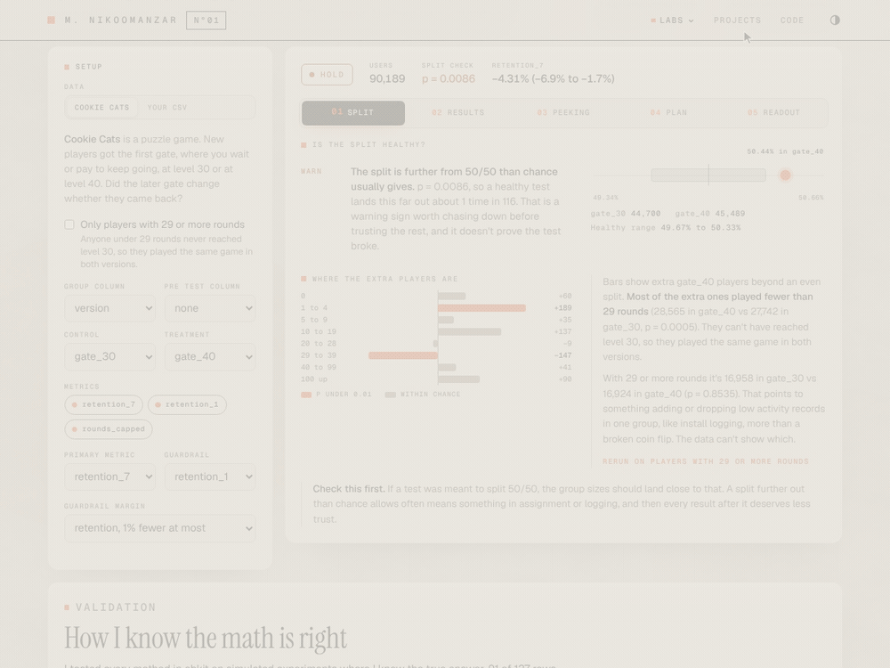
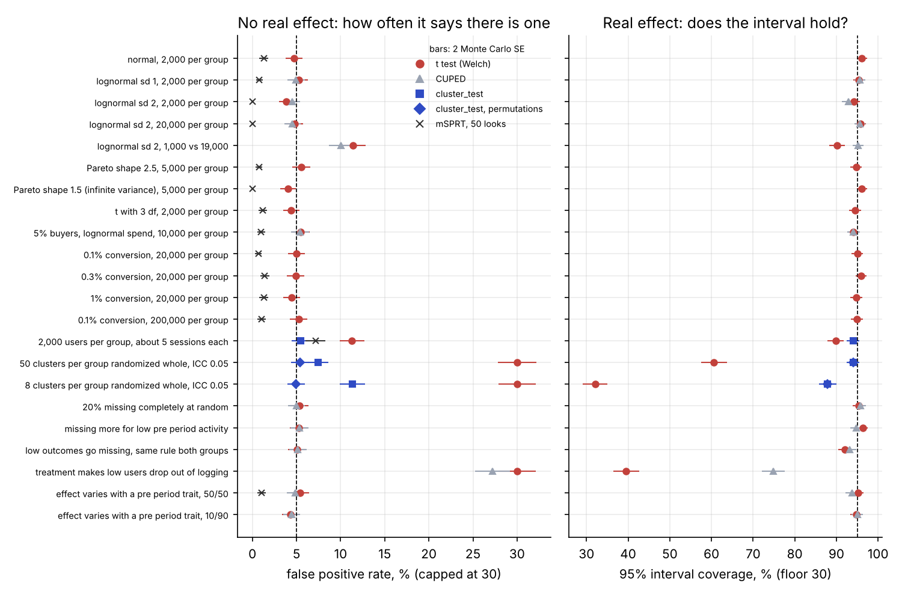
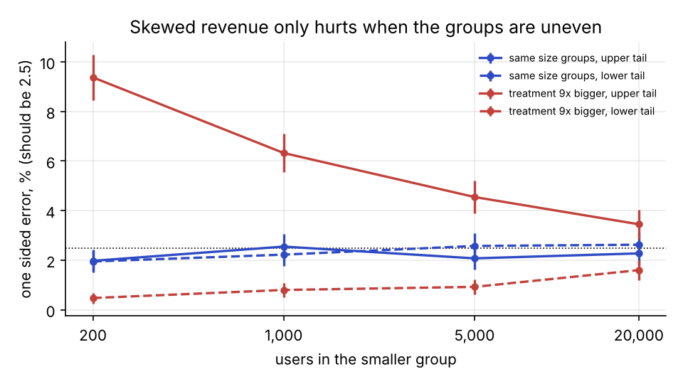
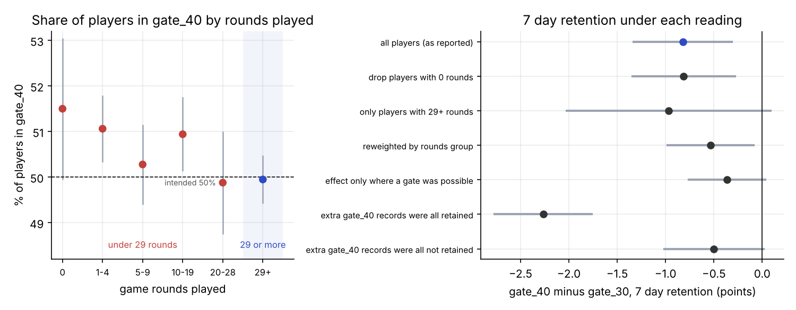

# abkit

A Python library and command line for planning, analyzing and reading out online A/B tests, with the simulations that show each method works, the stress tests that show where it breaks, and an analysis of a real experiment.



This is the Experiment Lab on the 90,000 player test. It starts at the split warning and then replays what peeking does.


## The short version

* If people check an A/B test every day and stop the first time it looks good, 39% of tests where nothing really changed get called winners. abkit's sequential tests keep that at 2%.
* I tested every method on made up experiments where I knew the right answer, 127 checks in all. Many use messy data (22 kinds, like skewed revenue, rare conversions, users with many visits and missing values). 91 pass. Of the 36 that don't, 18 are mistakes I ran on purpose to show what goes wrong, like counting one person's many visits as many people. The other 18 are real limits, and the validation table says which.
* Testing this hard found two real bugs in my own code for checking results early. Both are fixed, and tests would catch them coming back.
* I also ran it on a real experiment with 90,000 game players. The two groups came out slightly different in size, which is a warning sign. Most of the extra players quit before they could have seen the feature being tested. Looking only at players who could have seen it, the result points the same way but is less certain (p = 0.07 instead of 0.0016), mostly because that group is only 38% of the players.

The methods, tests and paper are one click down in the [docs](docs/README.md), the [validation table](docs/validation.md), the [paper](paper/abkit.pdf) and the [case study](docs/cookie_cats_case_study.md).

## Install

```bash
git clone https://github.com/MatinNikoo/abkit.git
cd abkit
pip install -e ".[plots,files]"      # charts, plus Parquet and Excel input
```

The core needs only numpy, scipy and pandas. Python 3.10 or newer.

You can also try the math in your browser. The [Experiment Lab](https://matinnikoo.github.io/lab.html) runs it on a real 90,000 player test or on your own CSV, step by step.

Most A/B test tutorials stop at a t test. Real experiments run into a few problems that a t test doesn't handle:

* People check results every day. If you peek at a normal p value and stop the first time it dips under 0.05, your false positive rate isn't 5%. In my simulations it was 21% after 10 looks and 39% after 100.
* Experiments are noisy and users are expensive. You can cut the noise a lot by using what you already knew about each user before the test started (CUPED, or a model's prediction with CUPAC).
* Some metrics are ratios, like clicks per session, and some tests randomize whole cities. Treating every row as independent makes the intervals too narrow.
* Assignment can break. If you meant to split users 50/50 and got 49.6/50.4 on 90,000 players, that's worth chasing down before you trust the results.
* Revenue is skewed. A few big spenders move the average, and with uneven group sizes the t test's errors pile up on one side.
* People want to know "what's the chance B is better?" That's a fair question, but the usual flat prior answer is overconfident when real effects are small, which they usually are.
* Teams track lots of metrics, arms and segments. Test 20 metrics, or split results by 10 countries, and you'll usually find a fake win somewhere.

## Try it

Clone the repo first (see Install above). Then in Python:

```python
import abkit as ab

exp = ab.Experiment(df, variant="group", control="A", treatment="B")
exp.check(pre_period=["visits_last_month"])        # sample ratio and balance checks
print(exp.analyze("revenue", covariate="revenue_last_month"))   # CUPED
print(exp.analyze("clicks", cluster="user_id"))    # rows grouped by user
print(exp.analyze_ratio("clicks", "sessions"))     # delta method
exp.analyze_many(["clicks", "orders", "revenue"])  # with false discovery rate control
print(exp.sequential("orders", mde=0.01))          # safe to check every day
print(exp.group_sequential("orders", n_looks=5))   # or at 5 planned looks
exp.guardrails({"load_time": 0.02}, higher_is_better={"load_time": False})
table, p_differ = exp.segments("orders", by="country")   # per segment, plus "do they really differ?"
print(exp.bayes("orders", prior_sd=0.004))         # chance B is better, with a prior from past tests
```

Or from the command line, with a file that has one row per user (CSV, TSV, Parquet, Excel or JSON):

```bash
abkit plan --name "Shorter checkout" --primary orders --baseline 0.10 --relative-mde 0.05 \
    --guardrail load_time:latency --sequential group --daily-users 3000 --out plan.md   # before the test
abkit report results.parquet --variant group --control A --treatment B --metrics orders revenue \
    --covariate revenue_last_month --segment country --guardrail load_time:latency --html readout.html
abkit report --config experiment.toml --json -     # the same options from a file, numbers as JSON
abkit size --baseline 0.19 --mde 0.01 --daily-users 4000   # how many users, how many days?
```

The `plan` command writes the question, the metrics, the sample size, the analysis and the decision rule before any data exists. The `--html` readout puts the checks first, then the results with a chart, and ends with a decision and the rule that made it. Both examples for Cookie Cats are in the repo, the [readout](examples/cookie_cats_readout.md) (the [HTML version](examples/cookie_cats_readout.html) shows as source on GitHub, so download it and open it in a browser) and the [plan](examples/cookie_cats_plan.md). Guardrail presets, JSON output, `--where` filters and the config file are in [the command line guide](docs/guide/command_line.md).

Charts for effects, segments, looks and daily lifts are in `abkit.plots`, and `Experiment` also takes a polars DataFrame or a file path directly.

## Does it actually work?

I can't prove a method works on real data, because I never know the true answer there. So every method gets tested on thousands of made up experiments where I do know it. Everything below comes from `simulations/run_simulations.py`.

| Claim | What I measured |
|---|---|
| Peeking at a normal p value breaks it | 2,000 A/A tests (no real difference), checked 100 times each: 39% falsely "won". The always valid test: 2.2%. |
| Always valid testing costs a little power but often stops early | For an effect of 0.06 sd: 92% power vs 99% for a single look at the end, but it stopped after 45% of the users on average. |
| CUPED removes about rho squared of the variance | Measured 9%, 25%, 49%, 81% at correlations 0.3, 0.5, 0.7, 0.9. Theory says 9%, 25%, 49%, 81%. |
| CUPED doesn't break the confidence intervals | 95% intervals covered the true effect 94% to 96% of the time at every correlation. |
| More pre period metrics remove more noise | One covariate removed 25% of the variance, two removed 50%, matching theory exactly. |
| Ratio metrics need the delta method | 95% intervals covered 96% of the time with the delta method, only 88% treating sessions as independent. |
| The sample size formula gives the power it promises | Promised 80%, got 82%, 80% and 79%. |
| Multiple testing corrections work | 20 metrics, 15 with no effect: some false win 53% of the time uncorrected, 4.4% with Holm. Benjamini Hochberg kept false discoveries at 3.8%. |
| A flat prior's "chance to win" is overconfident on small effects | When it said 85%, the better version won only 73% of the time. With a prior matching past tests, 86%. |
| Slicing by segment finds fake wins | A treatment that did nothing in any of 10 segments still looked significant in at least one segment 41% of the time. With the correction, 5.8%. The test for "do segments really differ" fired 6.1% of the time. |


I also checked every estimator against other people's code and published numbers. scipy and statsmodels cover the t test, delta method, cluster robust errors, regression adjustment, multiple testing, Dunnett and Mann-Whitney. The Jennison and Turnbull tables and published gsDesign values cover the group sequential boundaries. The worked example in Benjamini and Hochberg (1995) and a split check example from Kohavi, Tang and Xu (2020) cover two more. That's in `tests/test_reference.py`. I couldn't run R here, so nothing was compared against R directly.

## What happens on messy data

Clean simulations only go so far. Real metrics are skewed, users have many sessions, sometimes whole cities get randomized, values go missing. `simulations/stress.py` runs every method on 22 kinds of messy data, 2,000 experiments without an effect and 1,000 with one each, and [docs/validation.md](docs/validation.md) has the full pass/fail table with Monte Carlo error.



What I found:

* Skewed revenue only hurts when the groups are uneven. On lognormal revenue with skewness over 400, the t test gave 3.9% false positives at 2,000 users per group and 4.8% at 20,000. With 1,000 users in one group and 19,000 in the other it gave 11.4%, almost all on one side, and the 95% interval covered the truth 90.2% of the time. The library prints a skew note on every test like that. Capping the values fixes the false positives but cuts the estimated lift by a third, and the bootstrap options didn't fix it either (6.3% and 7.7% at 1,000 vs 9,000).
* Rare conversions alone are fine. From 0.1% to 1% conversion the t test gave 4.5% to 5.2% false positives, even at 0.1% with 20,000 users per group. Heavy tails are fine for the error rate too, but with infinite variance (Pareto shape 1.5) the t test only had 30.4% power.
* Users with many sessions break row level tests. Treating each session as a new observation gave 11.3% false positives. `cluster_test` gave 5.5%.
* Randomizing whole cities is worse. With 50 per group, a row level test gave 41.7% false positives and `cluster_test` gave 7.4% (5.4% with `permutations=999`). With 8 per group it was 66.3%, 11.3% and 5.0%, though the interval still only covered 87.9% there. A split check that counts users instead of cities flagged 73.7% (50 cities) and 87.3% (8 cities) of healthy experiments. Counting cities flagged none.
* Missing data is fine when it's random. When low outcomes go missing under the same rule in both groups, the estimate came out 20.8% too small and the missing value check noticed 12.8% of the time. When the treatment itself makes low users vanish from the logs, the t test gave 67.2% false positives and a +75% bias. The check caught that one 93.0% of the time, and nothing fixes it afterward.
* The always valid test stayed at or under 1.4% false positives everywhere except the sessions scenario (7.1%), where it treats rows as independent too.
* Effects that differ by user didn't hurt anything. CUPED even raised power from 59.8% to 94.5% in that scenario.



## Checking every day vs at planned looks

The always valid test (mSPRT) lets you look whenever you want, forever. If you can commit to a fixed number of looks and a maximum sample size, a group sequential design does better. O'Brien Fleming fits when the review schedule is fixed, and the mSPRT fits when people look whenever they like. Same 10,000 users per group:

| Method | False positives with no effect | Power at an effect of 0.04 sd | Share of users used at 0.04 sd |
|---|---|---|---|
| One look at the end | 4.7% | 80.0% | 100% |
| mSPRT, checked 50 times | 0.9% | 47.9% | 82% |
| O'Brien Fleming, 5 planned looks | 4.5% | 79.0% | 81% |
| Pocock, 5 planned looks | 4.9% | 71.3% | 71% |

## A real experiment: Cookie Cats

[Cookie Cats](analysis/cookie_cats.py) is a mobile puzzle game. 90,189 new players were randomly split between two versions. One put the first gate (where you wait or pay to keep playing) at level 30, the other at level 40.

* The split check failed. 44,700 vs 45,489 players, a sample ratio mismatch with p = 0.009. A healthy test lands there about 1 time in 116, so it's a warning sign, not proof that something broke. It's worth chasing down, and it's an easy check to skip.
* Most of the extra players had played fewer than 29 rounds. A player with fewer than 29 rounds can't have reached level 30 (assuming a level takes at least one round), so they played the same game in both versions. Among them gate_40 has 823 more players (p = 0.0005). Among players with 29 or more rounds the split is nearly even (16,958 vs 16,924, p = 0.85). The rounds buckets don't line up neatly, though. The 29 to 39 round players are off the other way (p = 0.00025), which I read as the gate itself. Overall this suggests something adding or dropping low activity records in one group, like install logging, more than a broken coin flip. The data can't show which.
* Moving the gate later probably hurt 7 day retention, and the evidence is weaker in the clean subgroup. On all players it was 19.0% vs 18.2%, a 4.3% relative drop (95% CI 1.7% to 6.9%), adjusted p = 0.005. Among players with 29 or more rounds, where the split is even, it was 43.4% vs 42.4%, p = 0.07. That group is only 38% of the players and its estimated drop is slightly bigger (0.97 vs 0.82 points), so most of the rise in p comes from having less data. Every way I looked at it keeps the direction, and about a third of the full sample gap comes from the different mix of players.
* 1 day retention and rounds played didn't clearly change.



The full investigation is in [the case study](docs/cookie_cats_case_study.md).

The replay uses a shuffled order. The data has no timestamps, so "checking it 50 times while it ran" means putting players in a random order and replaying. Over 1,000 shuffles the always valid test called the 7 day result every time, stopping after 22% to 100% of the players (median 78%). That shows how much the stopping point depends on luck. It can't show anything that depends on real time.


## What's in here

| Path | What it is |
|---|---|
| `abkit/core.py` | Welch t test, delta method, cluster test, CUPED, CUPAC, regression adjustment, non-inferiority, sample ratio check, segment heterogeneity, sample size |
| `abkit/sequential.py` | mSPRT always valid p values and confidence sequences, group sequential designs |
| `abkit/multiple.py` | Holm, Benjamini Hochberg, Dunnett |
| `abkit/bayes.py` | Chance to win, expected loss, and an optional prior from past experiments |
| `abkit/robust.py` | Bootstrap, quantile effects, Mann-Whitney, winsorizing |
| `abkit/design.py` | MDE, ratio metric power, run length, A/A simulator |
| `abkit/overtime.py` | Novelty and day of week checks |
| `abkit/experiment.py` | The `Experiment` class that ties it together |
| `abkit/data.py` | Reading files, polars and pandas input, and the error messages for bad columns |
| `abkit/plan.py`, `abkit/presets.py` | The written test plan, and guardrail presets |
| `abkit/plots.py` | Effect, segment, look and daily lift charts |
| `abkit/report.py`, `abkit/cli.py` | The readout (markdown, HTML, JSON) and the `abkit` command |
| `tests/` | 188 tests: reference checks, property based tests, guardrails, inputs, plans, charts, CLI, docs examples. Run with `pytest -q` |
| `simulations/` | The clean simulations, the stress tests, and the checks for the newer methods |
| `analysis/` | The Cookie Cats analysis and the split check investigation |
| `tools/` | Builds the validation table, the paper tables, and the golden test vectors |
| `examples/` | The Cookie Cats readout, plan and config file |
| `docs/` | A guide per method, the command line guide, the API, the validation table, the case study, the design doc |
| `paper/abkit.pdf` | A short write up of the methods and results |

## Run it

```bash
pip install -e ".[dev]"
pytest -q
make all          # data, tests, every simulation, Cookie Cats, the validation table and the paper
```

Or one step at a time with `make sims`, `make stress`, `make new`, `make cookie`, `make validation` and `make paper`. `requirements.txt` pins the exact versions the saved results came from. The simulations are seeded, so they reproduce exactly.

## Limits

* The mSPRT's guarantee uses a variance estimated from the data, so it's a large sample guarantee. In every stress scenario except sessions it stayed at or under 1.4% false positives, but small or weird samples aren't covered by theory.
* The sequential tests treat rows as independent. If users have many rows, that's wrong in the same way a row level t test is (7.1% false positives in the sessions scenario).
* With only a handful of clusters of very different sizes, `cluster_test`'s t version still runs a bit liberal. Use `permutations=`.
* No method fixes missing data that depends on the outcome. The missing value check catches one group losing more values. It doesn't catch loss that depends on the outcome when the rule is the same in both groups.
* The skew note uses a sample skewness, which is itself noisy for heavy tails.
* After CUPED, the relative interval divides by the control mean as if it were known, so it's slightly too narrow when the lift is big.
* Network effects (one user's treatment changing another's outcome) aren't handled.
* The Cookie Cats placebo assumes a level takes at least one round. The data can't confirm it.
* The effects chart colors a bar blue when its own interval excludes zero. It doesn't adjust for testing several metrics, so read it next to the adjusted p values.
* A plan's CUPED saving is a guess at a correlation. If the real one is lower, the test has less power than the plan says.
* Everything here is checked against software and published tables, but nobody outside the project has reviewed the methods yet. [docs/review_guide.md](docs/review_guide.md) lists what I'd most like checked.

## References

* Deng, Xu, Kohavi and Walker (2013). Improving the sensitivity of online controlled experiments by utilizing pre experiment data.
* Deng, Knoblich and Lu (2018). Applying the delta method in metric analytics.
* Johari, Koomen, Pekelis and Walsh (2017). Peeking at A/B tests.
* Howard, Ramdas, McAuliffe and Sekhon (2021). Time uniform, nonparametric, nonasymptotic confidence sequences.
* Jennison and Turnbull (2000). Group Sequential Methods with Applications to Clinical Trials.
* Lan and DeMets (1983). Discrete sequential boundaries for clinical trials.
* Lin (2013). Agnostic notes on regression adjustments to experimental data.
* Fabijan et al. (2019). Diagnosing sample ratio mismatch in online controlled experiments.
* Kohavi, Deng, Longbotham and Xu (2014). Seven rules of thumb for web site experimenters.
* Kohavi, Tang and Xu (2020). Trustworthy Online Controlled Experiments.
* Lee (2009). Training, wages, and sample selection: estimating sharp bounds on treatment effects.
* Cochran (1954). The combination of estimates from different experiments.
* Deng (2015). Objective Bayesian two sample hypothesis testing for online controlled experiments.
* Benjamini and Hochberg (1995). Controlling the false discovery rate.

The Cookie Cats data was released by Tactile Entertainment for a DataCamp project. The download script pulls a public copy from GitHub.

## License

MIT
